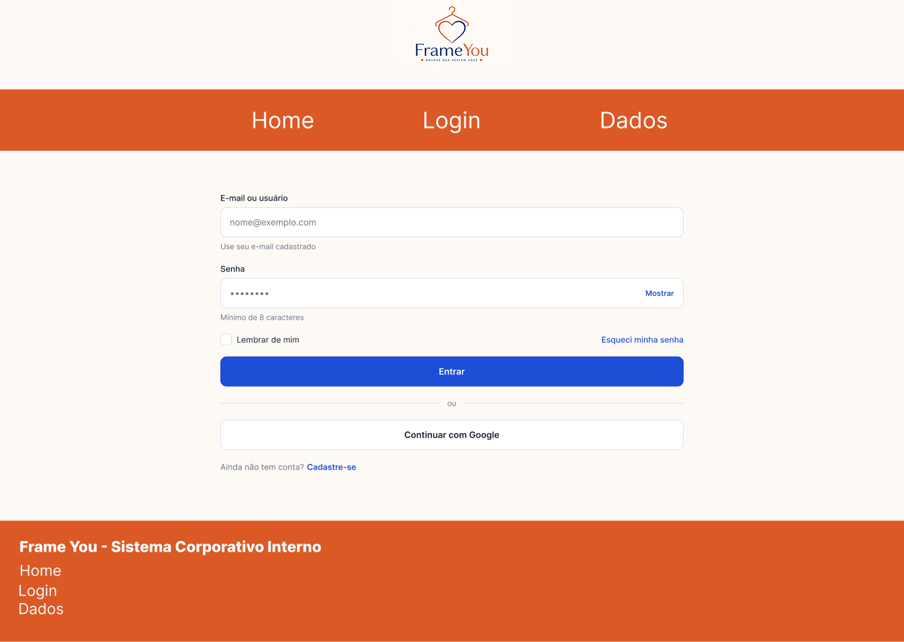
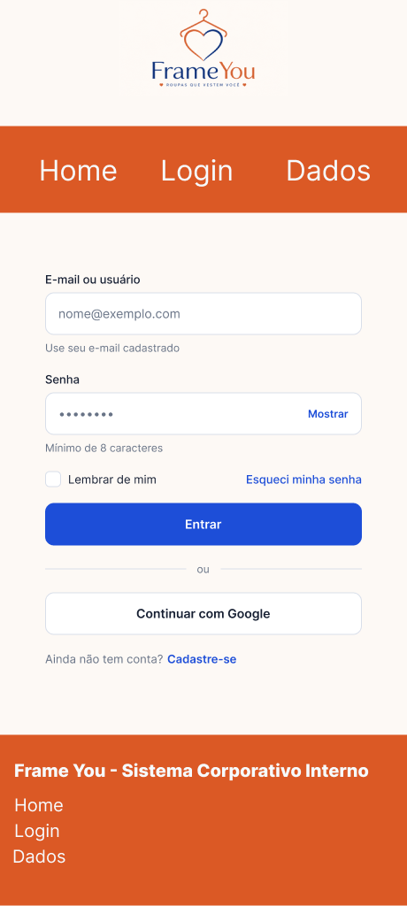
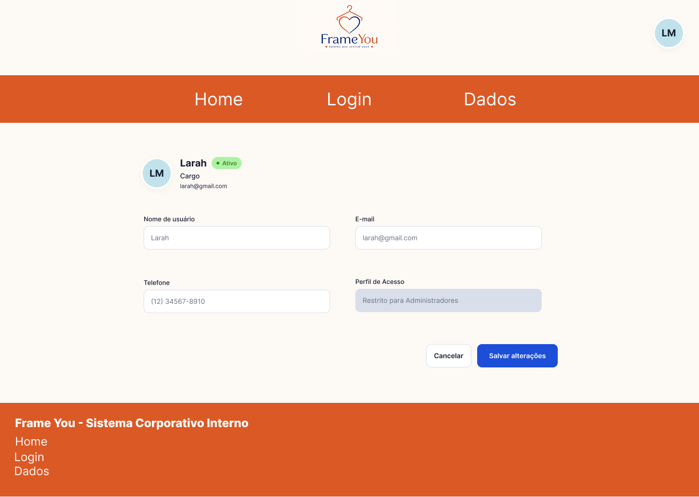
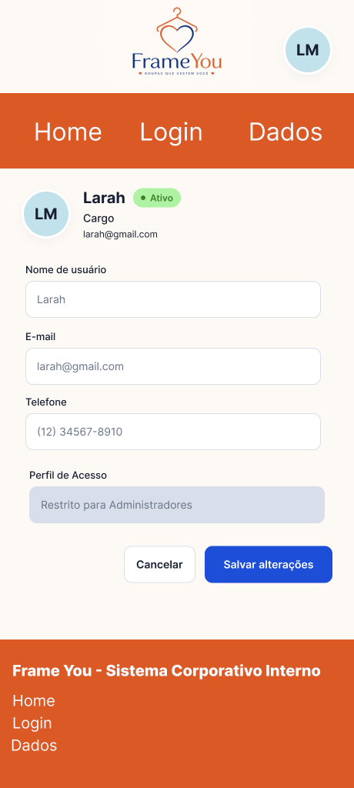
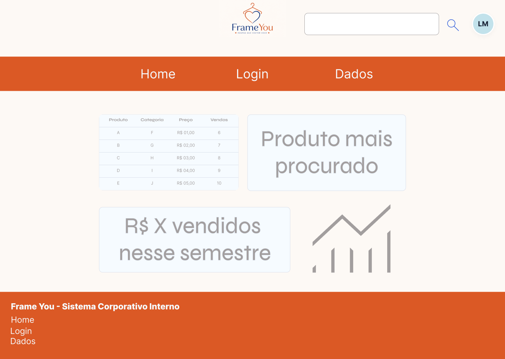
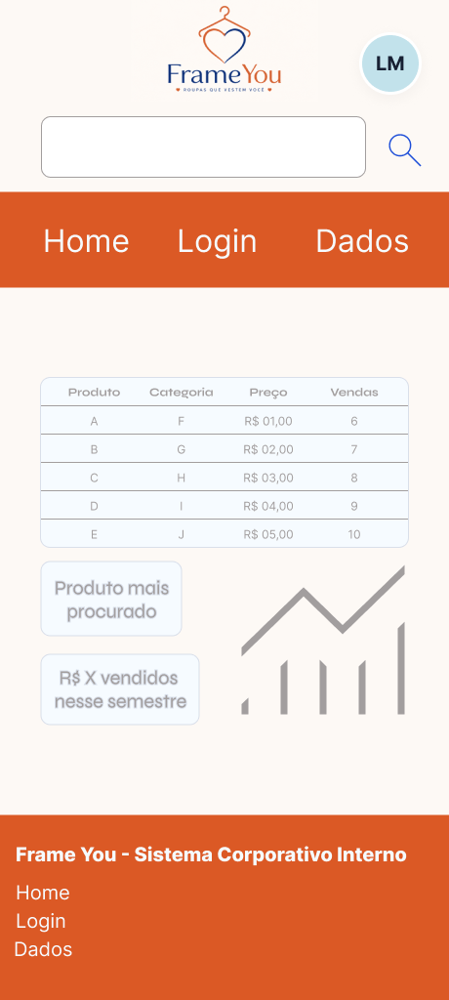

# Sistema Administrativo Interno da FrameYou

## 1. Matriz de Recursos Humanos

Esta matriz refere-se ao planejamento do sistema administrativo interno da FrameYou, desenvolvido para permitir que os colaboradores realizem login, visualizem seus perfis de usuário e consultem dados operacionais em uma tabela com campo de pesquisa.

Como o projeto será desenvolvido individualmente, ficarei responsável pelas atividades de planejamento, design e organização dos recursos. Os demais papéis serão considerados conforme as responsabilidades previstas no fluxo de trabalho.

| Papel | Responsabilidades |
|---|---|
| Designer UI/UX | Definir a identidade visual, organizar os componentes e desenvolver as versões Desktop e Mobile das telas no Figma. |
| Desenvolvedor Web | Preparar e otimizar os assets, organizar o repositório e, na etapa posterior, implementar as interfaces em HTML, CSS e JavaScript. |
| Cliente / Stakeholder | Validar os protótipos, verificar se as telas atendem às necessidades do sistema administrativo interno e aprovar o design antes da codificação. |
| Responsável pelo planejamento | Organizar as atividades, estimar prazos, definir a sequência das etapas e acompanhar as entregas. |


## 2. Matriz de Recursos Materiais

Os recursos materiais e tecnológicos necessários para o planejamento, a prototipagem e a futura implementação do sistema administrativo interno da FrameYou estão descritos a seguir.

| Recurso | Finalidade |
|---|---|
| Computador | Desenvolver o projeto, criar os protótipos e organizar os arquivos. |
| Figma | Criar e prototipar as telas de Login, Perfil do Usuário e Consulta de Dados nas versões Desktop e Mobile. |
| Visual Studio Code | Editar os arquivos HTML, CSS e JavaScript durante a etapa de implementação. |
| Git | Controlar as versões dos arquivos e registrar as alterações realizadas no projeto. |
| GitHub | Hospedar o repositório, disponibilizar o README.md e organizar os arquivos do projeto. |
| Google Fonts | Disponibilizar fontes tipográficas para a interface, caso necessário. |
| Bancos de imagens gratuitos | Obter imagens e recursos visuais para a interface, respeitando as respectivas licenças de uso. |
| Ferramentas de compressão de imagens | Reduzir o tamanho dos arquivos e otimizar o carregamento das imagens, utilizando formatos como WebP quando apropriado. |

**Observação:** os recursos serão utilizados conforme a necessidade de cada etapa. A implementação em HTML, CSS e JavaScript ocorrerá somente após a conclusão do planejamento e da prototipagem.


## 3. Cronograma Sequenciado de Desenvolvimento e Integração

O cronograma organiza as atividades necessárias para o desenvolvimento do sistema administrativo interno da FrameYou, considerando as etapas já concluídas e as atividades restantes.

| Etapa | Atividade | Descrição | Responsável | Situação |
|---|---|---|---|---|
| 1 | Estudo da identidade visual | Definir cores, tipografia, componentes e padrões visuais da interface. | Eu | Concluída |
| 2 | Prototipagem da tela de Login | Desenvolver os protótipos Desktop e Mobile da tela de autenticação. | Eu | Concluída |
| 3 | Prototipagem da tela de Perfil | Criar as versões Desktop e Mobile da página de perfil do usuário. | Eu | Concluída |
| 4 | Prototipagem da tela de Consulta | Desenvolver as versões Desktop e Mobile da tabela de dados com campo de pesquisa. | Eu | Concluída |
| 5 | Validação dos protótipos | Conferir se as telas atendem aos requisitos e realizar eventuais ajustes. | Eu | Concluída |
| 6 | Seleção e otimização dos assets | Conferir os recursos visuais utilizados e otimizar os arquivos quando necessário. | Eu | Concluída |
| 7 | Organização do repositório | Organizar os arquivos e a documentação, incluindo o README.md e os links do projeto. | Eu | Concluída |
| 8 | Conferência final da entrega | Verificar os protótipos, os recursos, a documentação e os requisitos da atividade. | Eu | Concluída |
| 9 | Implementação das interfaces | Desenvolver as interfaces em HTML, CSS e JavaScript. | Eu | Etapa futura |

**Observação:** as telas Desktop e Mobile já foram prototipadas no Figma. As situações das demais atividades devem ser atualizadas conforme o andamento real do projeto.

### 4.1. Protótipos no Figma

Os protótipos do sistema administrativo interno da FrameYou foram desenvolvidos nas versões Desktop e Mobile, contemplando as telas de Login, Perfil do Usuário e Consulta de Dados.

- **Link do projeto no Figma:** [Acessar protótipos](https://www.figma.com/design/SWyE4DoQcC5i984vA2uMc8/FrameYou---Projeto-de-Software-SA02?node-id=38-1409&t=EiKXAEOLkWNJlPaf-1)

### 4.2. Quadro Kanban do Trello

O quadro Kanban será utilizado para organizar as tarefas, acompanhar o andamento das atividades e controlar as etapas de desenvolvimento do projeto.

- **Link do quadro Kanban:** [Acessar quadro no Trello](https://trello.com/b/ImSCgtps/projetos-de-software-sa02-frameyou)


## 5. Estrutura de Pastas e Arquivos

```text
novaweb-projeto-inicial/
├── admin/
│   ├── assets/
│   │   ├── css/
│   │   │   └── style.css
│   │   ├── icons/
│   │   │   ├── caminhao_icon.png
│   │   │   ├── lupa-search_icon.png
│   │   │   ├── seguranca-escudo_icon.png
│   │   │   ├── troca_icon.png
│   │   │   └── usuario_icon.png
│   │   ├── images/
│   │   └── js/
│   ├── docs/
│   │   └── wireframes/
│   │       ├── Login-Desktop.png
│   │       ├── Login-Mobile.png
│   │       ├── Perfil-Desktop.png
│   │       ├── Perfil-Mobile.png
│   │       ├── Consulta-Desktop.png
│   │       └── Consulta-Mobile.png
│   ├── dashboard.html
│   ├── lista.html
│   └── login.html
└── README.md
```

**Observação:** a pasta `admin/docs/wireframes/` reúne as imagens dos protótipos exportadas do Figma. A pasta `admin/assets/images/` é destinada às imagens utilizadas diretamente na interface, enquanto `admin/assets/icons/` armazena os ícones.


## 4. EAP — Estrutura Analítica do Projeto

A EAP organiza o projeto em etapas e atividades menores, facilitando o planejamento e o acompanhamento do desenvolvimento.

| EAP | Atividade | Descrição |
|---|---|---|
| 1. Planejamento | 1.1 Levantamento dos requisitos | Identificar as necessidades do sistema administrativo. |
| 1. Planejamento | 1.2 Matriz de recursos | Registrar os recursos humanos e materiais necessários. |
| 1. Planejamento | 1.3 Cronograma | Organizar a sequência das atividades. |
| 2. Prototipagem | 2.1 Tela de Login | Criar os protótipos Desktop e Mobile. |
| 2. Prototipagem | 2.2 Perfil do Usuário | Criar os protótipos Desktop e Mobile. |
| 2. Prototipagem | 2.3 Consulta de Dados | Criar os protótipos Desktop e Mobile. |
| 3. Preparação dos recursos | 3.1 Seleção de assets | Conferir os recursos visuais necessários. |
| 3. Preparação dos recursos | 3.2 Otimização de arquivos | Otimizar imagens e outros recursos quando necessário. |
| 4. Documentação e entrega | 4.1 Organização do repositório | Organizar os arquivos e a pasta de imagens. |
| 4. Documentação e entrega | 4.2 Atualização do README.md | Documentar o planejamento, os links e os protótipos. |
| 4. Documentação e entrega | 4.3 Conferência final | Verificar os requisitos de entrega. |
| 5. Implementação futura | 5.1 Desenvolvimento das interfaces | Implementar as telas utilizando HTML, CSS e JavaScript. |
| 5. Implementação futura | 5.2 Testes e ajustes | Verificar a responsividade e o funcionamento das interfaces. |

**Observação:** a implementação e os testes funcionais são atividades futuras, não etapas já concluídas.


## 5. Links do Projeto

### 5.1. Protótipos no Figma

Os protótipos contemplam as telas de Login, Perfil do Usuário e Consulta de Dados nas versões Desktop e Mobile.

- **Link do projeto no Figma:** [Acessar protótipos](https://www.figma.com/design/SWyE4DoQcC5i984vA2uMc8/FrameYou---Projeto-de-Software-SA02?node-id=38-1409&t=EiKXAEOLkWNJlPaf-1)

### 5.2. Quadro Kanban do Trello

O quadro Kanban permite organizar as tarefas e acompanhar o andamento do projeto.

- **Link do quadro Kanban:** [Acessar quadro no Trello](https://trello.com/b/ImSCgtps/projetos-de-software-sa02-frameyou)


## 6. Imagens dos Protótipos no Figma

Esta seção apresenta os protótipos das telas do sistema administrativo interno da FrameYou nas versões Desktop e Mobile.

### 6.1. Tela de Login

**Desktop**



**Mobile**



### 6.2. Perfil do Usuário

**Desktop**



**Mobile**



### 6.3. Consulta de Dados

**Desktop**



**Mobile**

